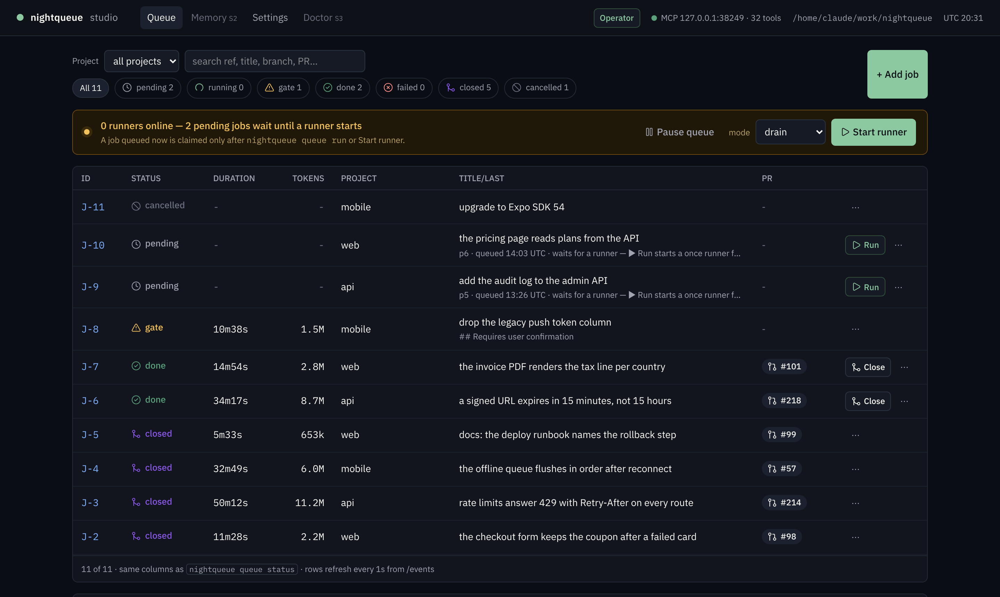
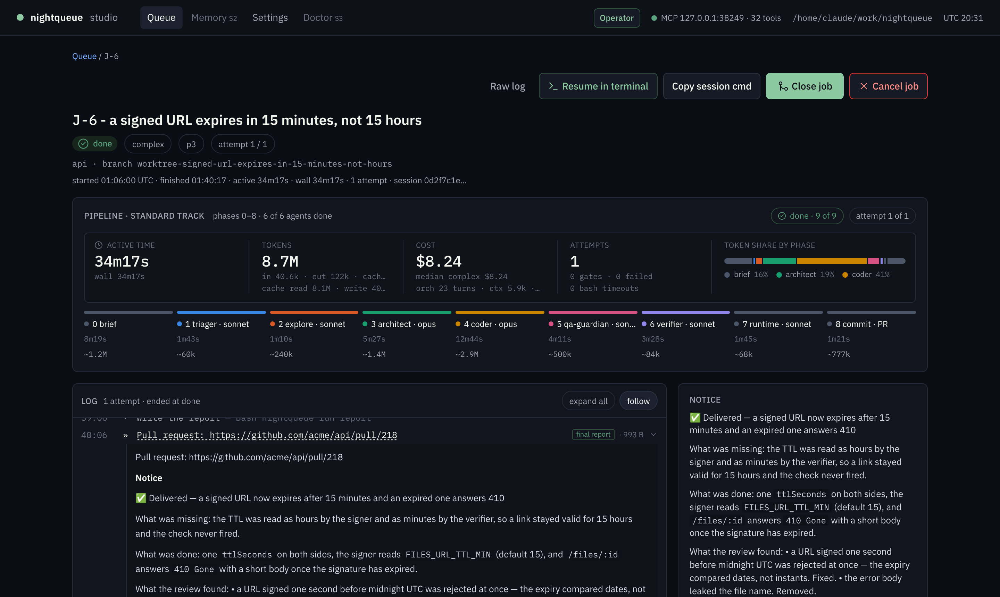
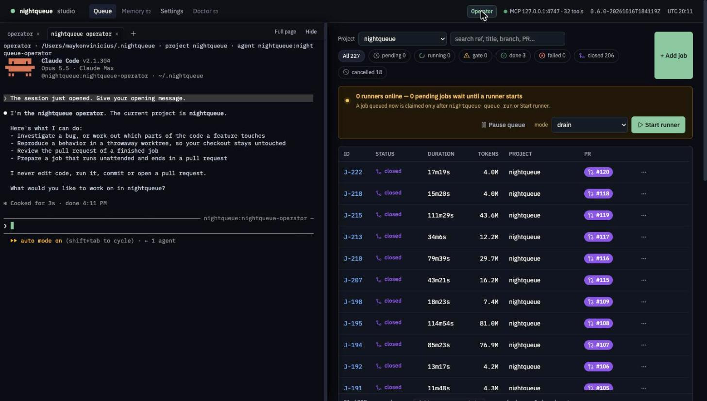
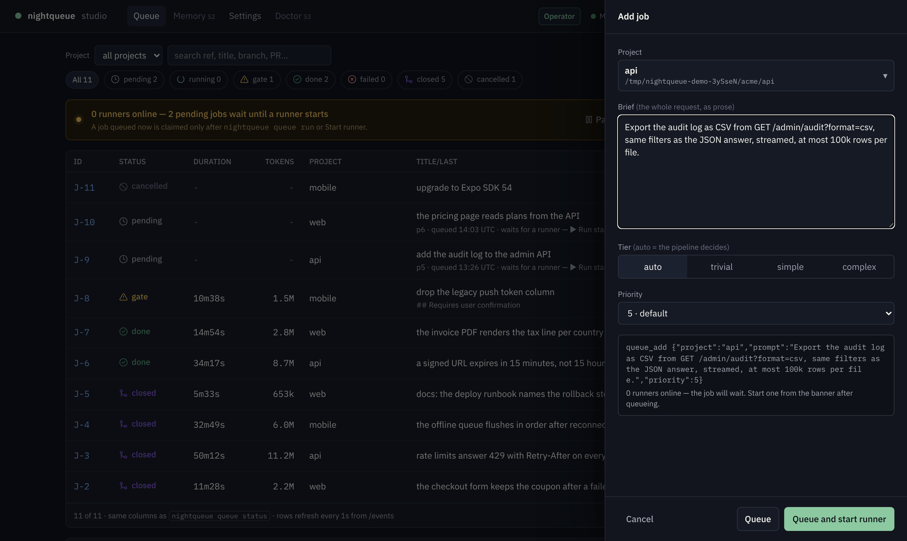
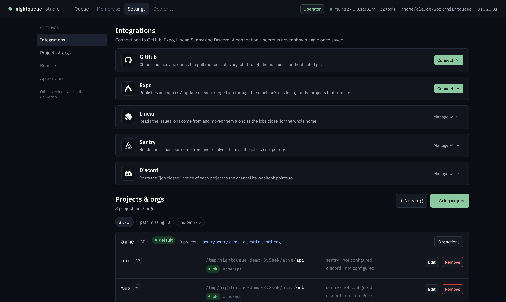

# nightqueue

**Issues in. Pull requests with proof out.**

[](https://www.npmjs.com/package/@nightqueue/nq)
[](https://github.com/nightqueue/nightqueue/actions/workflows/ci.yml)
[](package.json)
[](LICENSE)

A local queue of coding agents with a cockpit. Queue a job from a Linear issue
or a line of prose, watch the pipeline reproduce, root-cause, fix, attack and
verify it phase by phase, and come back to a pull request that carries its
evidence — Report → Cause → Changes → QA. A job that can't prove its fix stops
at a gate with a written notice instead of opening a PR.

[](docs/assets/studio-queue.png)

Queue the work during the day. Start the batch when you step away. Come back to
pull requests — and to an agent that remembers what it learned last night.

**Operate it however you work.** The [Studio](#the-studio) in the browser
(`nq studio`), `nq` in the terminal, or straight from Claude Code and Claude
Desktop through the MCP server. Same queue, same pipeline, same memory
underneath.

<p>
  <a href="https://nightqueue.github.io">Website</a> ·
  <a href="#quick-start">Quick start</a> ·
  <a href="#the-studio">Studio</a> ·
  <a href="docs/install.md">Install</a> ·
  <a href="docs/queue.md">Queue</a> ·
  <a href="docs/memory.md">Memory</a> ·
  <a href="docs/cli.md">CLI</a> ·
  <a href="docs/runtime-contract.md">Runtime contract</a> ·
  <a href="docs/developing.md">Developing</a> ·
  <a href="CONTRIBUTING.md">Contributing</a>
</p>

---

## What it is

nightqueue turns a coding request into a full pipeline run instead of a chat
session. Bugs and risky changes are triaged against real evidence, explored,
planned, implemented, attacked by an adversarial QA and verified against the
checks your project already defines; a docs or config change just runs those
checks. Then it opens the pull request. Every phase hands off through a file, so
a run can be inspected, resumed and audited after the fact.

It runs on **Claude Code**, with your own subscription, on your own machine.
Nothing leaves it.

## What it does

- **A backlog, not a chat.** `nightqueue queue add` records a deliverable;
  `nightqueue queue run` works through the whole backlog unattended and comes
  back with one pull request per job.
- **An 8-phase pipeline.** On bugs and risky changes: triage, exploration, architecture, implementation,
  adversarial QA, verification, runtime validation, commit and report — each
  phase run by a dedicated agent, each one gated by the previous artifact.
- **A memory that compounds.** Lessons, project memories and structural indexes
  survive between runs. The recall is hybrid (BM25 + optional local
  embeddings), scoped per project and per org, and every run makes the next one
  cheaper.
- **Human gates, not silent failures.** A job that needs a decision stops with a
  written notice; you answer it with one command and the job goes back to the
  queue.
- **Orgs and projects.** One home, many repositories, grouped by org, each with
  its own lessons and memory.

## How a job runs

```
queue add ─▶ triage ─▶ explore ─▶ architect ─▶ implement ─▶ adversarial QA ─▶ verify ─▶ runtime check ─▶ commit + PR
                │                                                                                          │
                └── every phase writes an artifact the next one is gated on; a gate stops the job ────────┘
                    with a written notice, and `queue retry <id> --note` sends it back
```

A low-risk change (docs, copy, config) skips straight to implement → verify → commit + PR.

Each phase is a dedicated subagent with its own instructions (`plugin/agents/`),
running inside a git worktree of your repository, in a job environment it cannot
leave. What it learns — lessons, memories, structural indexes of the codebase —
is written to a local SQLite home and recalled by the next job through the
nightqueue MCP server. The full promise between the pipeline and the runner is
written down in [docs/runtime-contract.md](docs/runtime-contract.md).

## The Studio

`nightqueue studio` serves the cockpit on `127.0.0.1` (port 4747 by default,
one token per start): the queue, every job phase by phase, an operator terminal
and the settings. Everything it does goes through the same runtime commands and
MCP tools the CLI uses — nothing is Studio-only underneath.

**A job, phase by phase.** The pipeline card shows the nine slots of the run
from second zero, each in its agent's colour; a slot the tier skips is hatched
and says why. Active time, tokens, cost and attempts, with the token share per
phase. The live log is a tree — phase → lane → event — with answers, hand-backs
and phase reports you can expand, and the notice the job wrote beside it.

[](docs/assets/studio-job.png)

**An operator beside the queue.** A Claude Code session in a terminal docked at
the bottom of every page, or split beside it. It runs `nightqueue open` in the
home — investigate a bug, make a small change on your checkout, review a
finished job's pull request, prepare the next job — and edits, runs commands or
writes git only after you consent; it never deletes files or force-pushes. `Resume in terminal`
reopens the session that did the work of any job in `gate`, `failed` or `done`.

[](docs/assets/studio-operator.jpg)

**Queue in prose, or from Linear.** `+ Add job` takes the project, the whole
request as prose, a tier (or lets the pipeline decide) and a priority, shows the
exact `queue_add` call it will make, and `Queue and start runner` starts the
batch at once. With Linear connected, the issues card below the queue lists the
workspace by team and project; `Queue` on an issue opens the drawer with it as
the job's origin.

[](docs/assets/studio-add-job.png)

**Integrations, orgs and projects.** GitHub, Expo, Linear, Sentry and Discord as
connections — a secret is never shown again once saved. Orgs and projects are
registered, edited and removed from the same page.

[](docs/assets/studio-settings.png)

The Studio needs no extra install: `studio/dist` ships in the package, the
terminal needs the optional `node-pty` (without it the Studio offers the command
to copy), and `nightqueue doctor` reports both. The screenshots above come from
`npm run studio:demo`: the real Studio over a throwaway home with three invented
projects and one scripted night (`npm run studio:shots` regenerates them).

## Where jobs come from, where you drive them

| In | Out |
|---|---|
| A Linear issue: `Queue` on the Studio's issues card, `origin: [{kind: "linear", ref}]` over MCP (from `tracker_issues`) or `--origin linear:MK-42` on the CLI | The Studio in the browser: queue, jobs, operator and settings (`nightqueue studio`) |
| A brief in prose: `+ Add job` in the Studio, or `nightqueue queue add "<request>"` in the terminal | The CLI: `nightqueue queue add`, `run`, `status` and `retry` |
| A plan under discussion in Claude Code: `/nightqueue:queue` | The MCP server, from any Claude client: `queue_add`, `queue_status`, and memory tools such as `lesson_recall` and `memory_recall` |

## Why nightqueue

| | A chat session | nightqueue |
|---|---|---|
| Who drives | you, prompt by prompt | the pipeline, phase by phase |
| Root cause | fixes what you described | reproduces first and fixes the cause on bugs and risky changes; proves every job |
| Memory | gone when the window closes | lessons and memories persist per org |
| Quality gate | whatever you remember to ask | your project's own checks on every run, plus adversarial QA on complex jobs |
| Output | a diff in a terminal | a reviewable pull request with a report |
| Visibility | a scrollback | the Studio: every job, phase by phase, with its cost and its notice |
| When it runs | while you watch | while you sleep |

Free, local and yours. A hosted **Team** tier — one shared queue and memory per
org, runners on your team's machines — is planned; the local product stays
free and is never degraded to push it.

## Quick start

Requirements: [Claude Code](https://claude.com/claude-code) and Node >= 22.

```sh
npx @nightqueue/nq init                       # install the runtime and set Claude Code up
# open a new terminal so `nightqueue` (and its shortcut `nq`) resolves
nightqueue doctor                                      # check the host and the home

nightqueue queue add "fix the flaky worker"            # queue one deliverable
nightqueue queue add "add the retry to the uploader"   # and the next one
nightqueue queue run                                   # start the batch, detached, when you step away

nightqueue studio                                      # the next morning: what each job became, phase by phase
nightqueue queue retry 7 --note "rename the column"    # answer a gate and send the job back (or Retry with a note, in the Studio)
```

Everything above has a button in the Studio. Inside Claude Code,
`/nightqueue:queue` turns the plan under discussion into a job, and
`/nightqueue:resolve <request>` runs the pipeline on the spot.

## Commands

The full reference is in [docs/cli.md](docs/cli.md); this is the daily set.

```sh
# queue
nightqueue queue add [project] "<request>" [--tier trivial|simple|complex] [--priority 1-9] [--run]
nightqueue queue run [--watch [s] [--from HH:MM] --until HH:MM] [--job J-<id>] [--stop]
nightqueue queue status [J-<id>|<PR URL>] [--follow] [--json]
nightqueue queue log <id> [--follow]
nightqueue queue session <id> [--print]
nightqueue queue retry <id> --note "<answer>"
nightqueue queue cancel <id> --reason "<why>"
nightqueue queue close <id> [--force] [--foreground] [--json]
nightqueue queue close --merged [--json]
nightqueue queue pause | resume
nightqueue studio [--port <n>] [--no-open]    # the Studio in the browser, on 127.0.0.1

# memory
nightqueue memory stats

# home
nightqueue org add|list|rename|key|remove|repair
nightqueue project add|list|key|move|remove
nightqueue connection bind|test|list|remove
echo "$LINEAR_API_KEY" | nightqueue connection add linear --type linear   # Linear issues, one per home
nightqueue doctor
nightqueue update [<version>]
```

**Writing a job.** One job is one self-contained deliverable that can be
reviewed and merged on its own. Large work is ONE job with numbered stages in
the prompt (`Stages: 1) ... 2) ...`), never several jobs that depend on each
other. See [Writing a job](docs/queue.md#writing-a-job).

**Closing a job.** A job ends `done` with an open pull request, and becomes `closed`
only when `nightqueue queue close <id>` merges that pull request through a recorded
pipeline - preflight, conflict, merge, settle - that resumes where it stopped.
`--force` skips the pull request checks and the rebase suite, never the job's status,
its attribution or a real conflict. A job you give up on is `queue cancel`-ed instead,
which also releases its worktree. See [Closing a job](docs/queue.md#closing-a-job).

**Running the queue overnight.** `nightqueue queue run --watch --from 22:00 --until
04:00` works the queue only inside that local time window, then exits - a
midnight-crossing window needs no special syntax. It is one-shot: nothing brings it
back once it closes, so a nightly schedule is an OS-level job (`launchd`, `systemd`)
you set up yourself. The machine is kept awake while a runner or a job needs it
(`queue.keepAwake`), but the display can still sleep - a closed lid with no external
display still stops the run, so keep it open. See [Running the
queue](docs/queue.md#running-the-queue).

## Status

nightqueue is pre-1.0 and used daily on real repositories. The CLI, the MCP tools
and the on-disk formats can still change between minor versions; every change a
user would notice is in [CHANGELOG.md](CHANGELOG.md), and a breaking one is
marked as such. Bugs and ideas go to the
[issues](https://github.com/nightqueue/nightqueue/issues); see
[CONTRIBUTING.md](CONTRIBUTING.md) before opening a pull request and
[SECURITY.md](SECURITY.md) for anything a guard should have caught. Everyone here
follows the [code of conduct](CODE_OF_CONDUCT.md).

## Documentation

| | |
|---|---|
| [Install](docs/install.md) | `init`, what it sets up, updating, trying without installing |
| [Queue](docs/queue.md) | jobs, runners, tiers, gates, logs, writing a job |
| [Memory](docs/memory.md) | lessons, memories, recall, the MCP tools |
| [CLI](docs/cli.md) | every command, configuration, `doctor` |
| [Runtime contract](docs/runtime-contract.md) | what the pipeline and the runner promise each other |
| [Developing](docs/developing.md) | tests, releases, contributing |

## License

Business Source License 1.1 — use it in production, for any purpose, including
inside a company; do not offer it to third parties as a hosted service or a
competing product. On 2029-09-04 it becomes Apache 2.0. `LICENSE` is the text
that governs.
